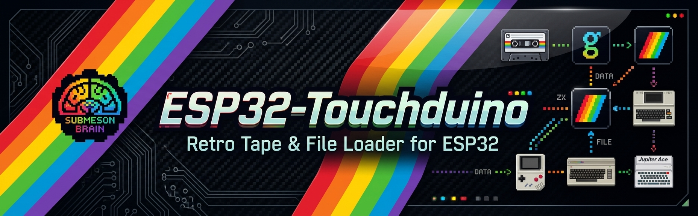
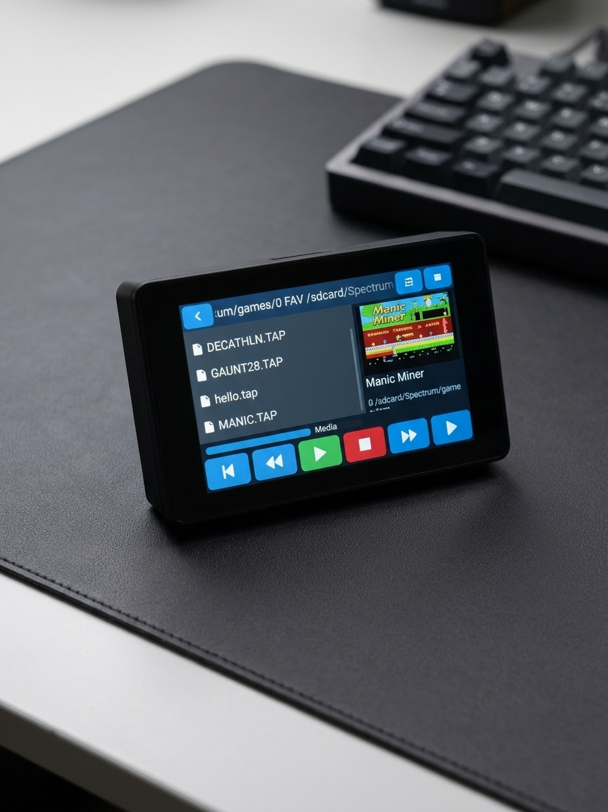
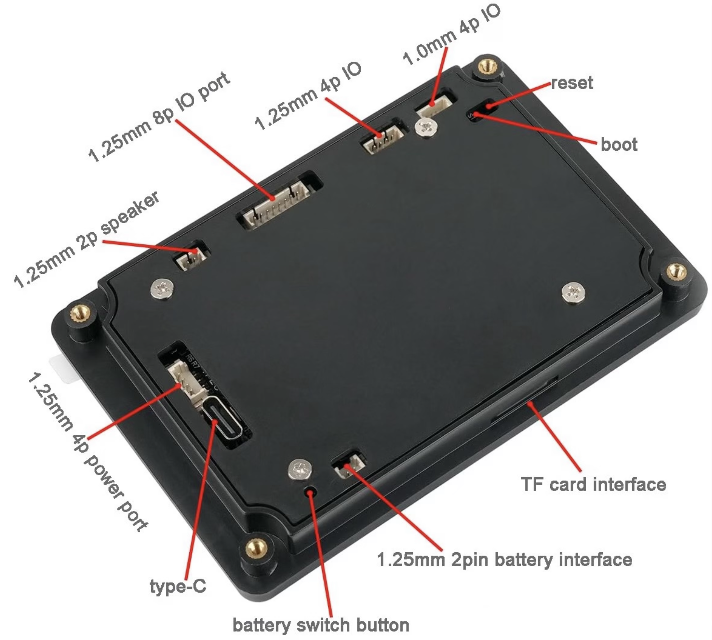
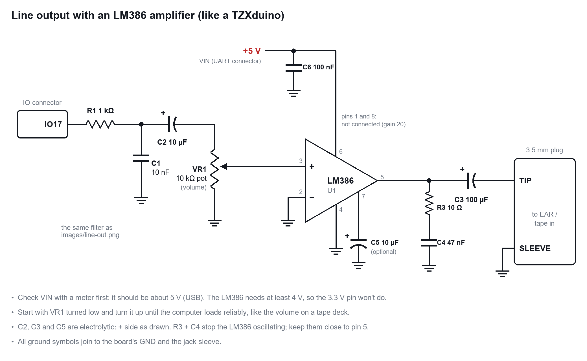

# TouchDuino

An ESP32-S3 port of [MaxDuino](https://github.com/rcmolina/MaxDuino), the tape emulator for 1980s home computers. It has a 3.5" touch screen in place of physical buttons. Put tape images on a microSD card, pick one on the screen, and TouchDuino plays it as a cassette signal for your Spectrum, Amstrad CPC, BBC Micro, MSX and other machines to load.

It runs on the Guition **JC3248W535** board:
- ESP32-S3 with 16 MB flash and 8 MB PSRAM
- 320×480 QSPI touch display
- microSD slot
- built-in speaker amplifier



*The screen is a real screenshot from the board, playing `MANIC.TAP` with its loading stripes in the preview border.*

> **Status:** working. Browsing, cover art, playback, the speaker and USB file transfer are tested on the board. Games load on a real ZX Spectrum 48K and 128K, a ZX81, an MSX, a BBC Micro, an Oric Atmos and an Amstrad CPC 464 through an LM386 line-out stage, and REM motor control works on the MSX, the BBC, the Oric and the CPC (see [Real-machine tests](#real-machine-tests)). The Commodore 64 is still to be tested.

## Features

- **Supported formats:** TZX, TAP, CDT, TSX, UEF, CAS, P, O, AY, MZF/MZT/M12, MTX, CAQ and Commodore 64 TAP. These use MaxDuino's format code, so timing matches the original.
- **Touch controls:** previous/next file, block back/forward, play/pause and stop, all as large buttons. There's also a progress bar and a status line, for example `PLAY Blk 6/6 TAP 2%`.
- **Glass-style screen:** dark gradient background, rounded panels and gradient buttons. Long folder paths and file names scroll.
- **File browser:** folders are listed first. It remembers the last folder you used.
- **Preview "TV":** the selected tape is shown on a small TV screen. The screen shows the first of these it finds:
  1. `game.jpg` or `game.png` next to `game.tzx` (baseline JPEG or PNG; progressive JPEGs aren't supported);
  2. for Spectrum `.tzx` and `.tap` files, the **loading screen inside the tape** itself. It is found by its `CODE 16384,6912` header, or as a 6,912-byte screen block on its own. Screens that a game unpacks or draws with a custom loader can't be found this way;
  3. `folder.jpg` or `folder.png` in the folder or any parent folder;
  4. a system badge, if a folder is named `Spectrum`, `Sinclair`, `Amstrad`, `CPC`, `BBC`, `MSX`, `Dragon`, `C64` or `Commodore`;
  5. otherwise a black screen with a gentle "loading" animation in the border.
- **Live loading border:** while a tape plays, the TV border is drawn from the real tape signal, lined up with what you hear, like the original loaders:
  - **ZX Spectrum:** red/cyan bands during the pilot tone and thin blue/yellow bands during data;
  - **Amstrad CPC and C64:** a different colour for each pulse, like their turbo loaders;
  - **ZX81:** the whole picture turns into slanted black and white stripes, the way a ZX81 looked on an old TV while it loaded (its picture stops during `LOAD`);
  - **other machines:** a plain border.

  The border goes black (or the machine's own border colour) whenever there's no sound. Drawing it never touches the tape timing.
- **Speaker:** the tape signal is mirrored to the onboard speaker, so you can hear it load. Volume is adjustable and there's a test beep.
- **Line out:** GPIO 17 outputs the signal for a 3.5 mm jack to the computer's EAR/tape input.
- **Motor control (REM):** in **Auto REM**, the computer's motor line on GPIO 18 pauses and resumes playback, and the header shows **REM ▶** or **REM ❚❚**. In **Force run** the line is ignored and the header shows **RUN**.
- **Options:**
  - speed for TSX/CAS/CDT (1200–3850 baud). UEF and Oric tapes always play at their standard speed;
  - **Shorten long gaps** (on by default): gaps over 5 s in the file play as 5 s. TZX transfers often contain long stretches of blank tape, such as 35 s after a loading screen. Turn it off if a game ever fails to load;
  - **Skip TZX block 2A** (on by default): ignores "stop the tape if in 48K mode" markers, which would wrongly pause 128K games;
  - **REM invert** (off by default): off, a closed REM contact means play; turn it on for a machine whose motor line works the other way round;
  - **Invert output** (off by default): flips the tape signal, for a machine or lead that needs the other polarity;
  - **USB file transfer:** the SD card appears on the PC as a USB drive, so files can be added without taking the card out;
  - MaxDuino's polarity/parity flag.

  Settings are kept after power-off.

## Hardware

| Function | GPIO |
| --- | --- |
| Display (QSPI) | CS 45, CLK 47, D0–D3 21/48/40/39, backlight 1 |
| Touch (I2C) | SDA 4, SCL 8 |
| microSD (SDMMC 1-bit) | CLK 12, CMD 11, D0 13 (CS/DAT3 10) |
| Speaker amp (I2S) | BCK 42, WS 2, DOUT 41 |
| **Tape out** | **17** |
| **Motor sense (REM)** | **18** (LOW = motor on / play) |

GPIO 17 and 18 are on the 4-pin expansion connectors (GND, 3.3V, IO17, IO18).



### Case

A 3D-printable case is in [case/](case/) (`Case_JC3248W535C.3mf` and `.stl`). The board sits in it turned 180 degrees, so the firmware draws the screen that way round (`APP_DISPLAY_ROTATION` = `LV_DISP_ROT_270` in `src/main.c`). For a bare board with the USB port on the other side, set it back to `LV_DISP_ROT_90`.

### Wiring the tape output

GPIO 17 on its own is too quiet for a real Spectrum: the loading tones were barely audible through its speaker. Like the ZAXON TZXduino, TouchDuino needs a small LM386 amplifier between the pin and the jack.



| Part | Value | Job |
| --- | --- | --- |
| R1 | 1 kΩ | Limits current from the pin; with C1 it rounds off the sharp edges |
| C1 | 10 nF | Low-pass filter with R1 (about 16 kHz), so even the fastest turbo loaders pass |
| C2 | 10 µF electrolytic, **+ toward the board** | Blocks the DC level of the 0–3.3 V signal |
| VR1 | 10 kΩ pot | Volume. The middle setting loads on a 48K and a 128K Spectrum |
| U1 | LM386 | Amplifier, gain 20 (pins 1 and 8 not connected) |
| C6 | 100 nF | Supply decoupling on pin 6, close to the chip |
| C5 | 10 µF (optional) | Bypass on pin 7, reduces hum |
| R3 + C4 | 10 Ω + 47 nF in series, pin 5 to GND | Stops the LM386 oscillating |
| C3 | 100 µF electrolytic, **+ toward the LM386** | Output coupling to the jack |

- **Power:** the LM386 runs from **+5 V on the VIN pin of the UART connector** (USB power). Check it with a meter first; the 3.3 V pin is not enough.
- **Plug:** jack **tip** carries the signal and **sleeve** goes to GND. With a stereo cable, joining tip and ring is fine.
- **Volume:** start with VR1 low and turn it up until the computer loads reliably, like the volume on a tape deck.

#### Easier option: a ready-made LM386 module

Instead of building the amplifier, you can use one of the cheap **LM386 amplifier module** boards sold for small speakers. They have the LM386, its capacitors and a volume pot on a small PCB.

- **Set the gain to 20:** most modules ship at gain 200, set by a part between pins 1 and 8 of the chip (marked R1 on the board tested). Remove it to leave pins 1 and 8 open, which gives gain 20 as in the circuit above. At 200 the signal is far too loud.
- **Wiring:** module **VCC** to +5 V (VIN on the UART connector), **GND** to GND, the module **input** straight to IO17 (no filter needed in front), and the module **output** to the jack tip, with its ground to the sleeve.
- **Volume:** the module's own pot replaces VR1. The middle of its travel loaded every test game.
- Tested on a ZX Spectrum 48K (Manic Miner, Decathlon) and 128K (D.N.A. Warrior, Auf Wiedersehen Monty, Marauder).

- **Without the amplifier:** the plain RC filter in [images/line-out.png](images/line-out.png) (the same parts up to C2, with a 4.7 kΩ resistor to ground) is enough for a scope or a quiet test, but not for the Spectrum we tried.
- **Don't connect a speaker straight to GPIO 17.** Use the board's speaker connector to listen. Don't use the speaker connector as a line out either: the onboard amplifier is a bridged class-D output, so neither speaker terminal is ground.
- **Different machines need different leads:**
  - **ZX Spectrum:** the EAR socket.
  - **Amstrad CPC 664/6128:** the DIN tape socket. The CPC 464's built-in deck needs a cassette adaptor or a modification.
  - **BBC Micro and Oric-1 / Atmos:** the 7-pin DIN cassette socket (its motor relay pins give REM). One lead works for both: ours is sold as a "BBC and Oric" tape lead.
  - **MSX:** the 8-pin DIN cassette socket (EAR in, plus the REMOTE relay pins for REM).
  - **Commodore 64:** has no audio input, so it needs a datasette-port interface instead of this circuit.
- **Motor sense (optional):** the computer's REM output is a switch (a relay contact) that closes while the motor should run. Wire it between GPIO 18 and GND. The pin has a pull-up, so closed means play. Select **Auto REM** in Options. If a machine works the other way round (playback pauses when the motor should run), turn on **REM invert**: then an open contact means play.
- **Auto REM without a cable:** with nothing on GPIO 18, Auto REM keeps playback paused. That's why the default is Force run.

## Real-machine tests

Loaded through an LM386 stage (the circuit above, or a ready-made module at gain 20) with the volume at about the middle, board on PC USB power.

**ZX Spectrum**

| Game | Machine | File | Result |
| --- | --- | --- | --- |
| Manic Miner | ZX Spectrum 48K | TAP | Loads (several runs) |
| Daley Thompson's Decathlon | ZX Spectrum 48K | TAP, Day 1 + Day 2 on one tape | Loads (several runs) |
| D.N.A. Warrior | ZX Spectrum 128K | TZX, 35 s gap shortened to 5 s | Loads |
| Auf Wiedersehen Monty | ZX Spectrum 128K | TZX, blocks back to back | Loads |
| Marauder | ZX Spectrum 128K | TZX, countdown loader | Loads |
| Marauder | ZX Spectrum 128K | TAP | Hangs after loading, but TouchDuino sent every byte correctly: a modified TAP; the TZX works |

**MSX** (a Just for Fun MSX1 kit, `RUN"CAS:"`)

| Game | File | Result |
| --- | --- | --- |
| Chase H.Q. | CAS, custom loader, multi-load | Loads at 1200 and 2400 baud. REM pauses and resumes at the exact byte on every relay change |
| Sorcery | CAS, BASIC loader + 3 files | Loads at 2400 baud. At 3600 and 3850: "Device I/O error" (too fast for this MSX) |
| Choplift | CAS | Plays to the end, then the MSX reboots: the loader reprograms the memory slots for one particular MSX model (a cartridge conversion), not a tape fault |

**BBC Micro** (Model B with a PiTube 6502 co-processor, `CHAIN""`)

| Game | File | Result |
| --- | --- | --- |
| Chuckie Egg | UEF, as downloaded (gzip-compressed) | Loads. REM pauses while the loader runs and between blocks, resuming at the exact byte |

**ZX81** (cherry-key self-build, `LOAD ""`)

| Game | File | Result |
| --- | --- | --- |
| 3D Monster Maze | P | Loads (about 2 min 20 s) |

ZX81 files are recognised by a `ZX81` (or `ZX80`) folder name or by the `.p`, `.81`, `.p81` and `.o` extensions, and get a ZX81 badge.

**Oric Atmos** (self-build, `CLOAD""`)

| Game | File | Result |
| --- | --- | --- |
| Manic Miner | TAP (Oric) | Loads, with Auto REM starting the tape when `CLOAD""` switches the motor on (the game then asks for its original unlock code) |

Oric files go in a folder named `Oric` (or `Atmos`) for the Oric badge. Oric `.tap` files are told apart from Spectrum ones by their header.

**Amstrad CPC 464** (self-build with an external tape input, `RUN""`)

| Game | File | Result |
| --- | --- | --- |
| Amstrad Diagnostics | CDT, 7 blocks | Loads and runs |
| Auf Wiedersehen Monty | CDT, custom loader, one 64 KB block at a faster speed | Loads. REM pauses and resumes between blocks |

**Not tested yet:** Commodore 64 (it needs a datasette-port adapter).

Machine notes:
- **MSX:** start at Baud **2400** (or 1200). Faster settings may give "Device I/O error". Some multi-load games say "stop the tape" while leaving the motor on: press ❚❚, not ■, so the tape stays at the next level.
- **BBC Micro:** UEF files always play at 1200 baud, whatever the Baud setting. Downloaded UEFs can be copied straight to the card.
- **Amstrad CPC:** use `RUN""` (CTRL + small ENTER), not `LOAD""`. `LOAD""` stops with "Memory full" after the first header on machine-code tapes that load low in memory, even on a healthy machine.
- **Oric:** an Oric file has a single short header at the very start, so the tape must start after `CLOAD""`, not before. With **Auto REM** on, press ▶ first: TouchDuino waits at REM ❚❚ until `CLOAD""` switches the motor on. Without REM, type `CLOAD""` and then press ▶. `Loading ..  C` on the top line means it found the header (C = code, B = BASIC; the name can be blank). Oric tapes always play at standard speed, whatever the Baud setting.

**Self-check:** while a tape plays, TouchDuino decodes its own output the way the Spectrum ROM does. For each standard-speed block, the serial log shows a line like
`selfcheck block 5: 32770 bytes, flag 0xFF, parity OK, ... 0-half 244..244 us, 1-half 489..489 us`.
If a game fails to load and every block says *parity OK* at the right length, the data left TouchDuino intact: look at the lead, the volume or the file instead. Turbo blocks aren't decoded, and the last block of a file shows a few extra bytes from MaxDuino's end-of-file flush, which the computer ignores.

## Building and flashing

You need [PlatformIO](https://platformio.org/) (VS Code extension or CLI). The first build downloads ESP-IDF 5.2 and the toolchain, which takes a while.

```bash
pio run                  # build
pio run -t upload        # flash (board shows up as a USB serial port)
pio run -t monitor       # serial log at 115200
```

The project uses ESP-IDF with LVGL 8.4. ESP-IDF settings live in `sdkconfig.defaults`. After you change that file, delete the generated `sdkconfig.jc3248w535` so it gets rebuilt.

If an upload fails with `No serial data received` after the stub starts, unplug and replug the board, or flash with esptool's ROM loader, which is slower but more tolerant:

```bash
python ~/.platformio/packages/tool-esptoolpy/esptool.py --chip esp32s3 --port COM9 --baud 115200 --no-stub write_flash 0x10000 .pio/build/jc3248w535/firmware.bin
```

## Using it

1. **Prepare the card.** Format a microSD card as FAT32 (FAT16 is fine for small cards) and copy your tape files onto it. Folders are fine, for example `/Spectrum/Games/Manic Miner.tzx`. Long file names work.
   - UEF files can be copied as they are: most archive UEFs (Stairway to Hell and others) are gzip-compressed, and TouchDuino unpacks them in memory when you press play.
2. **Browse.** Tap a folder to open it, and ◀ (or `..`) to go back. ↻ re-reads the SD card: use it after swapping cards, since the board can't detect a card change by itself. It stops playback first.
3. **Play.** Tap a file to select it and see its preview, then tap again or press ▶. ▶ toggles pause while playing and ■ stops. While a tape is playing or paused, browsing is locked and the preview stays on that tape: press ■ to choose another file. The status line shows **End of tape** when it finishes.
4. **Skip blocks.** ◀◀ and ▶▶ jump between data blocks in TZX/TSX/CDT and Spectrum TAP files.
5. **Multi-load games.** Some games load in parts, such as days, levels or sides.
   - **TZX images** often contain "stop the tape" markers, and TouchDuino pauses there; press ▶ when the game asks. "Stop if 48K" markers are ignored unless you turn off **Skip TZX block 2A**.
   - **TAP files** have no such markers and play straight through. Pause after a part has loaded and resume when the game asks for the next one, as you would with a real cassette.
6. **Options.** The ⚙ screen (scroll it for more) holds:
   - **Baud:** the speed for MSX CAS, TSX and CDT files. 2400 is the fastest our MSX loads; 3600 and 3850 gave "Device I/O error". UEF files ignore it and always play at 1200, the speed a BBC or Electron expects.
   - **Motor: Auto REM:** on, the computer's REM line pauses and plays the tape; off, the tape plays straight through (Force run).
   - **REM invert:** off, a closed REM contact means play (correct for the MSX, BBC, Oric and CPC tested); turn it on if playback pauses when the motor should run.
   - **Invert output:** flips the tape signal on GPIO 17 (the speaker, border and self-check are unaffected). None of the tested machines needed it; try it if a machine never finds the tape.
   - **Onboard speaker**, **Speaker volume** and a **Test** beep.
   - **Shorten long gaps**, **Skip TZX block 2A** and the MaxDuino **Polarity / TSX accel / UEF parity** flag.
   - **USB file transfer** (see below).
7. **USB file transfer.** Instead of taking the card out, turn on **Options → USB file transfer**. TouchDuino restarts into a USB drive screen and the SD card appears on the PC as a drive called *TouchDuino SD card*: copy, rename and delete files and make folders as usual. Tape playback is off, and the COM port is gone, while the drive is attached. Eject the drive on the PC, then press **Exit**: TouchDuino restarts and reads the card again.
8. **Screenshots.** Press and hold the folder path at the top for about a second. The current screen is saved to the card as `screenshot.bmp`, and the header shows **✓ Saved screenshot.bmp**.

## How it works

The aim is that touching the screen can never disturb the tape timing.

- **Core 1:** the tape engine and its pulse timer. The timer drives the ESP32-S3 timer hardware directly from internal RAM (IRAM), so playback keeps running even while flash is busy.
- **Core 0:** the display, touch, SD browsing, cover-art decoding and the speaker task.

The display controller has to receive every update as a whole frame, starting from the top. To keep drawing cheap, LVGL redraws only the parts of the screen that changed into fast internal RAM, and these are merged into a full-frame copy that's streamed to the panel. A still screen costs nothing, and an animated border frame takes about 30 ms, mostly waiting on the display transfer.

The format code in `src/engine/` is copied from MaxDuino almost unchanged. Small compatibility layers stand in for the Arduino pieces it expects:

| Original MaxDuino | TouchDuino replacement |
| --- | --- |
| Arduino core | `Arduino.h` |
| SdFat | `file_utils.cpp` (standard C file reads with a cache) |
| AVR timers | `TimerCounter.cpp` |
| `MaxDuino.ino` main loop | `engine.cpp` |

See [CLAUDE.md](CLAUDE.md) for detailed developer notes.

| Path | Contents |
| --- | --- |
| `src/engine/` | MaxDuino engine plus ESP32 glue, the speaker output (`monitor.cpp`) and the public API (`tape_engine.h`) |
| `src/ui/` | LVGL touch UI and cover-art decoder |
| `src/app/` | SD card mounting and saved settings |
| `src/esp_bsp.*`, `esp_lcd_*`, `lv_port.*` | Board support for the display and touch |

## Credits

- **[MaxDuino](https://github.com/rcmolina/MaxDuino)** by Rafael Molina Chasserot and contributors, building on TZXDuino (Andrew Beer, Duncan Edwards) and CASDuino. TouchDuino's tape engine is their work.
- **[JC3248W535EN](https://github.com/NorthernMan54/JC3248W535EN)** by NorthernMan54, the ESP-IDF + LVGL base project for this board.
- **[LVGL](https://lvgl.io/)**, the graphics library.

MaxDuino doesn't include a licence file. Check with its authors before you redistribute builds of this firmware.
